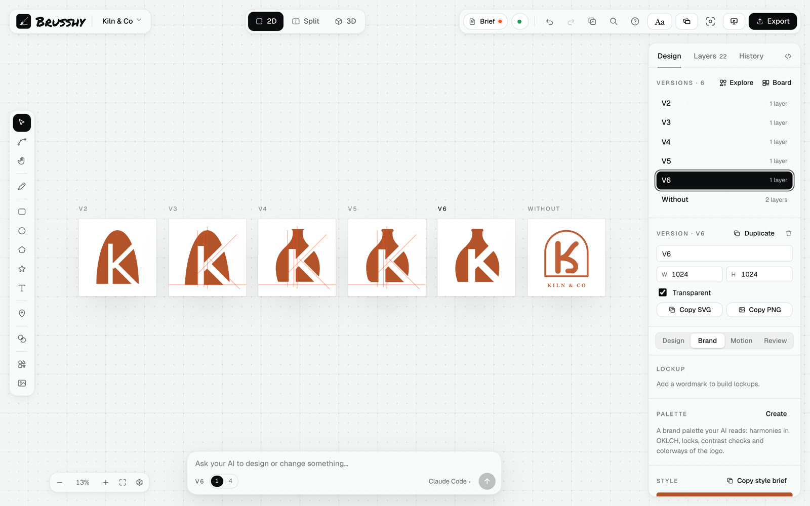

# Brusshy



**Design logos with your own AI.** Brusshy is an open-source, local-first logo studio: run `npx brusshy`, a drafting-table canvas opens in your browser, and **your own AI** (Claude Code, Codex, Gemini, Grok, Cursor or any MCP client) designs on it with your plan while you watch, guide and edit by hand. Real vectors, every version, every check, every export — no account, no server, no AI bill from us.

```bash
npx skills add mavsy11/brusshy -g   # install the design skill
npx brusshy init                    # connect your AI to the canvas (once per project)
npx brusshy                         # open the studio for this folder
```

Your AI opens a blank canvas in your browser when it starts. You watch the logo appear live and can edit it by hand at any point.

- **Your AI draws, you direct** — sketch, trace, pin notes on exact parts, lock what you love, chat from the canvas.
- **Craft tools** — construction grids and shape builder, exact repeats, refine, Type Lab (axes, OpenType, warp, effects), shapes library, local vectorizer for sketches and photos.
- **Proof, not vibes** — critique scores, 16 px checks, lockup metrics, contrast, mockups, compare.
- **The whole system** — lockups, palette and colorways, type pairing, 3D, animation, presentation deck, timelapse, brand kit.

## Try these

Paste one into your AI, or into the chat on the canvas:

```text
Design a logo for Northwind, a specialty coffee roaster in Lisbon. Modern and warm, not rustic. Must work as an app icon and a 16 px favicon. One idea, symbol + wordmark.
```

```text
Turn my sketch into a clean vector logo. Keep the proportions; fix the symmetry.
```

```text
The gap between the dot and the play closes at 16 px. Open it up.
```

```text
Critique the active version and pin the fixes as notes.
```

```text
Make a horizontal lockup and a version for dark backgrounds, then show it on a business card and as an app icon.
```

## Learn more

**Docs:** [Getting started](docs/getting-started.md) · [Feature tour](docs/features.md) · [Vectorize a photo or object](docs/guides/vectorize.md) · [Prompts that work](skills/logo-designer-studio-brusshy/references/prompts.md)

**Design skill for AI agents:** [`skills/logo-designer-studio-brusshy`](skills/logo-designer-studio-brusshy/SKILL.md) — process, techniques, craft, critique and the full tool map. Install it into your AI client with `npx skills add mavsy11/brusshy -g`.

License: [MIT](LICENSE) · [Third-party notices](THIRD_PARTY_NOTICES.md) · [Security](SECURITY.md) · [Contributing](CONTRIBUTING.md)

---

## Packages

| Package | What |
|---|---|
| `packages/core` | Document model (zod schema), atomic invertible ops, undo history, geometry, SVG import/export, 3D presets, wire protocol |
| `packages/shapes` | The SVG shapes library (parametric shapes + open-license symbols) |
| `packages/brusshy` | The published CLI: local daemon (HTTP + WebSocket, persistence), MCP server and tools, `init`/`stop` |
| `packages/studio` | The canvas app (React + Vite): 2D editor, three.js 3D view, export pipeline |

## Develop

```bash
npm install
npm test                 # core + daemon tests
npm run typecheck
```

Run the daemon (dev mode) against a scratch project and the studio with hot reload:

```bash
BRUSSHY_DIR=.dev-project npx tsx packages/brusshy/src/cli.ts start --dev --no-open
npm run dev              # studio on http://localhost:5173 (proxies /api and /ws to the daemon)
```

Drive it like an agent would, without an AI client:

```bash
npm run build -w brusshy
node packages/brusshy/test/draw.mjs .dev-project set_svg '{"svg":"<circle cx=\"512\" cy=\"512\" r=\"200\" fill=\"#ff4d1f\"/>"}'
```

## Build & try the published shape

```bash
npm run build            # core typecheck → studio build → CLI bundle (+ studio copied into dist/)
cd /some/project && node /path/to/brusshy/packages/brusshy/dist/cli.js        # = npx brusshy
node /path/to/brusshy/packages/brusshy/dist/cli.js init                       # writes .mcp.json / .cursor/mcp.json
```

## How it fits together

```
your AI ──MCP stdio──▶ brusshy mcp ──HTTP (token)──▶ daemon ◀──WebSocket──▶ studio (browser)
                                                    │
                                     brusshy/*.brusshy.json · refs/ · brand/ · exports/
```

- The daemon is the single source of truth. Every change — yours or the AI's — is an op; one undo history for both.
- The AI sees its own work with `render_preview` (2D/3D renders come from the studio; 2D falls back to the server).
- Security: binds `127.0.0.1`, rejects foreign `Host`/`Origin`, every API call and the WebSocket need a per-run token (in `brusshy/.daemon.json`, mode 600; the studio receives it in the URL fragment).
