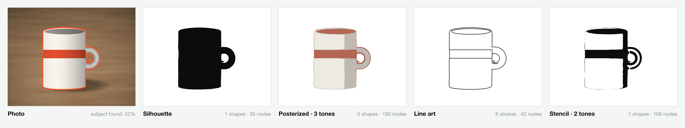
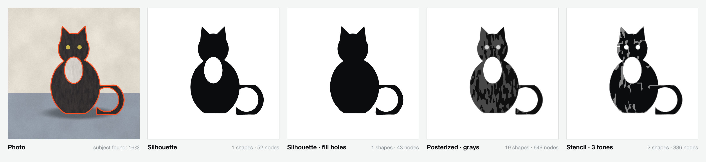
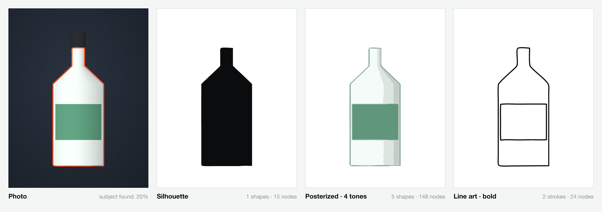
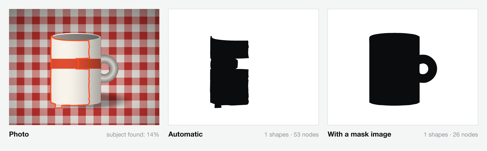

# Vectorize a photo or a real object

Brusshy can turn a photo of a real thing — a mug, your dog, a hand-painted sign, a product — into clean vector paths you can build a logo from. It runs entirely on your computer: no upload, no cloud service, no AI model. The same tracer runs in the studio (live preview) and in the MCP server (when your AI does it).

The trace is **raw material, not the logo**. It gives you the true proportions and the recognizable outline of the object; the logo comes from simplifying it and designing on top.

*Synthetic test photo rendered in code. Left: the photo with the subject Brusshy found (orange outline). Then the four styles, with default settings.*

## Take a photo that traces well

Background removal works by looking at the **edge of the photo**: whatever is there is treated as background, and the object is whatever stands out from it. So:

- **Plain background.** A sheet of paper, a wall, a tablecloth without a pattern. Wood grain and soft texture are fine; checks, stripes and clutter are not.
- **Contrast.** Dark object on a light background or light on dark. A white mug on a white table is the hardest case.
- **Leave a margin.** Keep the whole object inside the frame with some background all around it. If it touches the edge, crop so it doesn't — or crop tightly on purpose and turn **Remove background** off.
- **Soft side light.** A window to one side gives shape without hard shadows. Avoid direct flash (glare) and harsh top light. Brusshy ignores cast shadows on the background (they have the background's color, only darker), but a soft shadow is easier than a black one.
- **Straight on.** Shoot the side you want in the logo, square to the camera, and fill most of the frame. Phone photos are plenty; the tracer works at 800–1 200 px.
- **One subject.** For several objects, use **Keep** to keep the N largest.

## In the studio

1. Drop or paste the photo on the canvas (it becomes a *reference image*: you can trace over it, it is never exported).
2. Select it and click **Vectorize…** in the right panel (or press ⌘K and run **Vectorize photo…**). Photos open on the **Photo / Object** tab; sketches and flat artwork open on **Sketch / Artwork** — you can switch at any time.
3. Check the **Subject** view: the background is dimmed and the detected outline is drawn in orange. If it is wrong:
   - Background kept → raise **Background tolerance** (or set **Subject** to *Darker* / *Lighter*).
   - Parts of the object missing → lower the tolerance, or turn **Ignore shadows** down if a dark part was mistaken for a shadow.
   - A light patch inside the object cut out (a white chest on a cat, a label) → **Fill holes**.
   - Something else in the shot → drag on the photo to **crop** around the object (handles to adjust, *Reset crop* to undo).
4. Pick a **Style**. Each card shows a live thumbnail of your object:
   - **Silhouette** — one solid shape. The most logo-ready start.
   - **Posterized** — 2–6 stacked tonal layers, in the photo's colors or grays. Lightest at the bottom, so there are never gaps between layers.
   - **Line art** — the outline and the main inner edges as centerline strokes (adjust **Line weight**).
   - **Stencil** — 2 or 3 tones where every enclosed piece is tied to the outside with a **bridge**, so it can be cut from vinyl, card or a stencil sheet.
5. Fine-tune: **Exposure**, **Contrast** and **Denoise** prepare the photo; **Detail**, **Smoothing**, **Corners**, **Min region** and **Clean-up** shape the curves. Hold **Hold for original** to compare with the photo; **Over photo**, **Result** and **Outlines** show the paths.
6. **Add paths** (⌘↵). The result lands as one named group (e.g. *Silhouette trace — mug*) exactly over the photo, as one undo step.

*The floor shadow is ignored automatically. The white chest matches the wall, so it is cut out as a hole — Fill holes closes it. A furry texture gives busy posterized and stencil layers; raise Smoothing or Min region for calmer shapes.*

*A light subject on a dark, uneven background. The black cap is as dark as the backdrop, so it is lost — a limit of any background-based cut-out (see below).*

## With your AI

Your AI uses the `vectorize_reference` tool with `mode: "photo"`. It previews first (`apply: false` returns the photo with the detected subject next to the result), tunes, and then applies. Things to ask:

- "Vectorize the mug photo as a silhouette, then turn it into a simple, bold logo mark."
- "Trace my dog's photo as line art, keep only the head, and redraw it as a friendly single-line icon."
- "Make a 2-tone stencil from the bike photo so I can cut it in vinyl."
- "Posterize the storefront sign photo in 3 tones and use the shapes as the base for a vintage badge."
- "The trace kept the table — crop around the object and raise the tolerance."

The tool's answer reminds the AI of the next steps: simplify (drop stray bits and minor tones, fewer nodes), then design on top in clean geometry, check with `render_preview` and `check_small_sizes`, and hide the raw trace when the clean version is done.

Parameters (all optional): `style` (silhouette · posterized · lineart · stencil), `subject` (auto · darker · lighter), `tolerance`, `shadows`, `keep`, `fill_holes`, `isolate`, `cleanup`, `crop` (`{x, y, width, height}` in 0–1 fractions), `mask`, `exposure`, `contrast`, `denoise`, `detail`, `smoothing`, `corners`, `specks`, `tones`, `palette`, `bridges`, `weight`, `color`, `apply`.

## Better isolation with a local model (optional)

The built-in isolation has no machine learning on purpose: it is small, deterministic, license-clean, and good on photos taken as above. For hard photos (busy backgrounds, a subject that shares the background's colors) you can bring your own mask — Brusshy ships no model and needs none.

*The white squares of the cloth match the mug, so automatic isolation fails. With a mask image the trace is clean.*

Any of these work:

1. **A transparent cut-out.** Remove the background with any tool you run locally and drop the resulting PNG with transparency. Brusshy uses the alpha channel as the subject automatically.
2. **A mask image for the AI.** Put a black-and-white (or transparent) mask next to the photo, e.g. `brusshy/refs/mug-mask.png` (white or opaque = subject, any size — it is stretched over the photo), and ask: "vectorize the mug photo with the mask refs/mug-mask.png". The tool's `mask` parameter takes the project path.
3. **In code.** `vectorizePhoto(image, { subjectMask })` in `@brusshy/core` accepts any RGBA image as the mask (alpha, or luminance when it is opaque). A local segmentation model can produce it; the crop and the clean-up still apply.

If you use a segmentation model, check its license (code *and* weights) before you ship anything made with it inside your own product.

## How it works

1. **Crop and prepare**: the crop is cut out, downsampled to the working size (Detail), adjusted for exposure and contrast, and blurred to remove grain (Denoise).
2. **Background model**: a smooth color surface (a quadratic in OKLab) is fitted to the photo's border ring, robustly, so gradients and vignettes are understood; up to three color clusters of the ring cover two-tone backdrops such as wall + floor.
3. **Distance and shadows**: each pixel gets its distance from that model. Pixels that look like the background dimmed — same hue, lower lightness — count as cast shadow.
4. **Flood fill**: the background grows inward from the border through pixels within the tolerance (automatic: above the background's own noise and close to the split between background and subject). Enclosed pockets that look like clean background (a handle loop) become holes.
5. **Clean-up**: morphological open/close, keep the N largest subjects, fill pinholes (or every hole).
6. **Style**: silhouette traces the mask; posterized and stencil split the subject into tonal classes (k-means on lightness, or color) stacked lightest-first; stencil layers get bridges along the shortest path from each enclosed island to the outside; line art finds edges (Sobel, non-maximum suppression, hysteresis) inside the subject plus its outline and traces their centerlines.
7. **Curves**: the shared tracer follows the edges with sub-pixel accuracy, keeps real corners, and fits least-squares cubic curves with as few nodes as the tolerance allows.

## Limits

- Isolation is based on the **background at the border**: a subject that shares the background's colors, a busy pattern, or an object cut off by the frame confuse it. Crop, adjust the tolerance, or use a mask.
- Parts of the subject that match the background (a black cap on a black backdrop, a white patch on a white wall) are lost or cut out as holes. *Fill holes* fixes the second case only.
- Strong highlights and reflections (glass, chrome) read as background-colored patches.
- Fur, hair and foliage become noisy outlines in posterized and stencil styles — raise Smoothing, Min region and Clean-up, or prefer Silhouette.
- Line art follows edges in the photo, not the strokes an illustrator would draw: expect to delete some lines and redraw others.
- Very large photos are downsampled (about 1 200 px at Detail 100); small details below a few pixels at that size disappear.
- For pencil sketches, scanned drawings and flat logo files, use the **Sketch / Artwork** tab (`mode: "lines"` or `"shapes"`).

The example images in this guide are generated by [`img/make-images.ts`](img/make-images.ts) from synthetic photos rendered in code: `npx tsx docs/guides/img/make-images.ts`.
